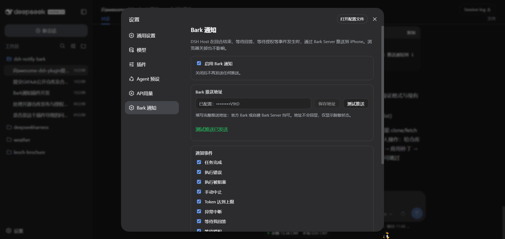
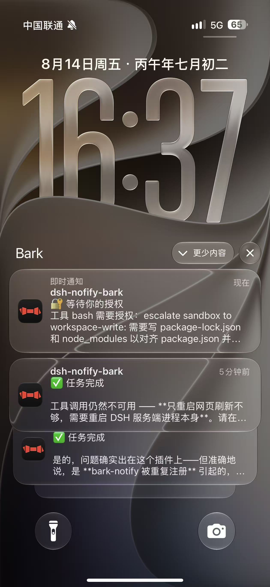
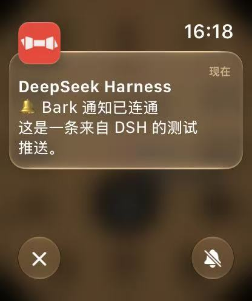

# dsh-notify-bark

> **License:** MIT · **Requires:** Node ^22.19 · **DSH:** 0.2.2-rc.1 (inlined client module table era) · **Platform:** DSH Host + Web settings page

**[English](README.md) · [简体中文](README.zh-CN.md)**

A [Bark](https://github.com/Finb/Bark) push-notification plugin for [DeepSeek Harness](https://github.com/deepseek-ai/deepseek-harness) (DSH): the **DSH Host** listens for events such as turn completion, waiting for your answer, and waiting for approval, and pushes notifications to your iPhone through a Bark Server. Notifications are sent entirely from the Host — closing the browser, refreshing the page, or putting your computer to sleep does not affect delivery.

- **Host half** (`src/index.ts` + `lib/*.js`): session/event listener + Bark HTTP sending + the plugin entry's own `Config` schema (volatile fields persisted and hot-applied through DSH 0.2's `ctx.settings` document) + the `barkNotify` Typert Remote served on the shared `/api` channel.
- **Browser half** (`src/client/` + `lib/client.js`): registers a `settings.section` slot; the form calls the mounted `barkNotify` Remote namespace. **The Bark URL never crosses the wire to the browser** — only a masked status is shown (configured: `••••••••3F82`).

  

  

  

## Notification events (9 switches)

| Event | Trigger | Default | Bark level |
| --- | --- | :-: | --- |
| ✅ Task completed | `turn/end` reason `completed` | On | `active` |
| ❌ Execution failed | `turn/end` reason `error` | On | `timeSensitive` |
| 🚫 Execution blocked | `turn/end` reason `blocked` | On | `timeSensitive` |
| ⏹ Aborted | `turn/end` reason `aborted` | Off | `passive` |
| ⚠️ Token limit reached | `turn/end` reason `max-tokens` | On | `timeSensitive` |
| ⏸ Interrupted | `turn/end` reason `interrupted` | On | `timeSensitive` |
| ❓ Awaiting your answer | `tool/call` `ask_user_question` | On | `timeSensitive` |
| 🔐 Awaiting your approval | `approval/asked` | On | `timeSensitive` |
| 📋 Plan awaiting confirmation | `tool/call` `exit_plan_mode` | Off | `timeSensitive` |

The notification title is fixed to the workspace name (last path segment of `session.header.cwd`); the status is placed on the first line of the body. Optional extras: the AI's last reply text, a body length cap, and a Bark Group.

## Installation

Install directly from GitHub (the repo ships compiled output — clone and use, no build step required):

    dsh plugin --profile web add https://github.com/pc439527/dsh-notify-bark.git

Or from a local path:

    dsh plugin --profile web add /path/to/dsh-notify-bark

`dsh plugin add` runs `pnpm add` (writing dependencies + `dsh.profile.bundles`), and the plugin's own `cordis.patch.yml` inserts the `bark-notify` line. **A running dsh web watches the profile's `cordis.patch.yml` through Cordis HMR** — appending the same insert line at the user layer hot-loads the plugin without restarting the service:

    # $DSH_HOME/profiles/web/cordis.patch.yml
    - insert:
        - id: bark-notify
          name: 'dsh-notify-bark'

Refresh the browser settings page (gear → Bark notifications) to see the configuration form.

## Security & privacy

- **No built-in keys:** `barkUrl` defaults to empty; each deployer fills in their own Bark URL on the settings page (`https://api.day.app/your-key`). This repository contains no real credentials (tests use only a fake `testkey`).
- **Credentials never reach the browser:** `barkUrl` is declared `role('secret')` in the schema; the Remote get answers only a masked status (configured: `••••••••3F82`) and logs only `configured: true/false`.
- **Config is stored on the Host only:** written to the profile's DSH settings document on the Host and never uploaded to any third party; notifications are sent only to the Bark URL you configured.
- **Paste-friendly endpoint field:** you can paste Bark's documented `curl` example (e.g. `curl -X GET 'https://api.day.app/KEY/title/body?...'`) — the plugin extracts the embedded URL and reduces it back to the base endpoint; non-URL text is rejected with an actionable error instead of an opaque parse failure.

## Development

    pnpm install              # typescript / @types/node + the DSH 0.2 peer types (lockfile: pnpm-lock.yaml)
    pnpm run typecheck        # Host half against the installed DSH 0.2 packages
    pnpm run typecheck:client # browser-half source against the DSH 0.2 client packages
    pnpm run build            # tsc compiles the Host half to lib/; the client bundle is maintained directly in lib/client.js
    pnpm test                 # node:test unit + smoke tests (send / mapping / defaults / dedup / masking / remote contract / client bundle)

## Structure

    dsh-notify-bark/
    ├── package.json          # dsh.client declaration + bundle patch declaration + repo metadata
    ├── pnpm-lock.yaml        # pnpm lockfile
    ├── cordis.patch.yml      # plugin line insertion
    ├── LICENSE               # MIT
    ├── src/
    │   ├── index.ts          # Host entry: Config schema + event listener + Remote service
    │   ├── bark-service.ts   # Bark HTTP sending (timeout / error classification)
    │   ├── event-listener.ts # session/event → notification intent (dedup / title / content)
    │   ├── settings-store.ts # settings model / schema / defaults / masking
    │   ├── remote-contract.ts # shared Remote contract: payloads, validation, descriptors
    │   ├── bark-remote.ts    # barkNotify Remote service (get masked / set / test)
    │   └── client/           # browser-half source (lib/client.js is its bundle mirror)
    ├── lib/                  # deployment artifacts (tsc-compiled Host + hand-maintained module-loader bundle)
    └── tests/                # node:test unit tests

## Design notes

- **Notifications go through the Host:** `ctx.on('session/event')` listens directly (the same path dsh-im-bridge uses); the browser is only a configuration panel.
- **Config is stored on the Host:** on DSH 0.2 a plugin entry *is* its settings namespace, so the plugin exports a `Config` schema whose fields are `volatile()` (stable live references, no remount) and writes go through `ctx.settings`. The plugin suppresses the auto-generated page (`configure({ auto: false })`) and owns its `settings.section`; the `barkNotify` Remote keeps reads masked and set write-only.
- **Settings writes are revision-fenced:** the set method reads the entry's revision from `ctx.settings.describe()` and passes it to `ctx.settings.update()`, so a stale editor cannot silently overwrite a concurrent change.
- **Credentials never reach the browser:** `barkUrl` is `role('secret')` and the Remote returns only masked status (`configured: ••••••••3F82`); logs output only `configured: true/false`.
- **Event dedup:** `sessionId` + `event.seq` key with a bounded ledger, so reconnects or replays never push duplicates.
- **No RPC channels were harmed:** the `barkNotify` methods ride the standard Typert `/api` gateway (SRC discovery from the live service), not a custom `connection.rpc.handle` channel — the one surface that cannot work cross-plugin on DSH 0.2.

## References & acknowledgments

- Architecture patterns referenced (design only — no code copied):
  - **dsh-im-bridge** — the session/event listening path (internal DeepSeek plugin, not public);
  - **dsh-codex-auth** — the pattern of a settings page reading/writing Host config through a dedicated RPC (internal DeepSeek plugin, not public).
- Plugin platform: [DeepSeek Harness](https://github.com/deepseek-ai/deepseek-harness) (MIT).
- Push service: [Bark](https://github.com/Finb/Bark) (open-source iOS push service) — this plugin only sends HTTP requests to the Bark URL you configured; it does not include or distribute Bark code.

## License

[MIT](LICENSE). Provided as-is, without any express or implied warranty; any loss arising from use of this plugin is borne by the user. Contributors agree to license their contributions under MIT.

---

