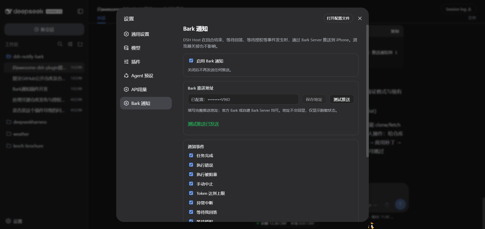
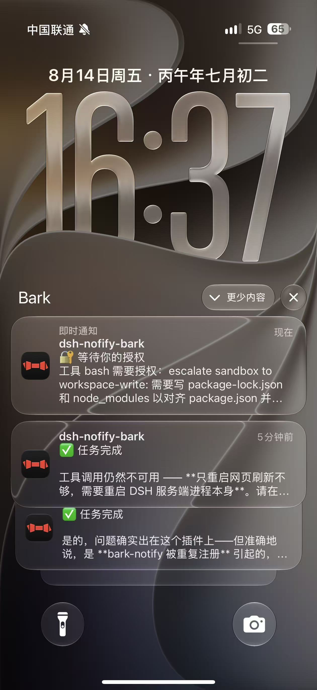
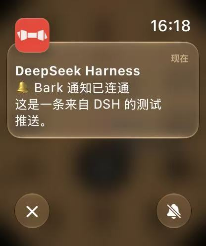

# dsh-notify-bark

> **License:** MIT · **Requires:** Node ^22.19 · **DSH:** 0.2.2-rc.1（内联 client 模块表时代） · **Platform:** DSH Host + Web 设置页

**[English](README.md) · [简体中文](README.zh-CN.md)**

[DeepSeek Harness](https://github.com/deepseek-ai/deepseek-harness)（DSH）的 [Bark](https://github.com/Finb/Bark) 推送通知插件：**DSH Host 端**监听回合结束、等待回答、等待授权等事件，通过 Bark Server 把通知推送到 iPhone。通知完全在 Host 发送——浏览器关掉、页面刷新、电脑休眠都不影响推送。

- **Host 半端**（`src/index.ts` + `lib/*.js`）：session/event 监听 + Bark HTTP 发送 + 插件条目自带的 `Config` schema（volatile 字段经 DSH 0.2 的 `ctx.settings` 配置文档持久化并热生效）+ barkNotify Typert Remote（随共享 `/api` 通道提供）。
- **浏览器半端**（`src/client/` + `lib/client.js`）：注册 settings.section 插槽，表单经挂载的 `barkNotify` Remote 命名空间读写 Host 配置；**Bark 地址永不下发到浏览器**，只显示脱敏状态（已配置：`••••••••3F82`）。

  

  

  

## 通知事件（9 个开关）

| 事件 | 触发条件 | 默认 | Bark level |
| --- | --- | :-: | --- |
| ✅ 任务完成 | `turn/end` reason `completed` | 开 | `active` |
| ❌ 执行失败 | `turn/end` reason `error` | 开 | `timeSensitive` |
| 🚫 执行被阻塞 | `turn/end` reason `blocked` | 开 | `timeSensitive` |
| ⏹ 已中止 | `turn/end` reason `aborted` | 关 | `passive` |
| ⚠️ Token 达到上限 | `turn/end` reason `max-tokens` | 开 | `timeSensitive` |
| ⏸ 异常中断 | `turn/end` reason `interrupted` | 开 | `timeSensitive` |
| ❓ 等待你的回答 | `tool/call` `ask_user_question` | 开 | `timeSensitive` |
| 🔐 等待你的授权 | `approval/asked` | 开 | `timeSensitive` |
| 📋 计划待确认 | `tool/call` `exit_plan_mode` | 关 | `timeSensitive` |

标题固定为工作区名（`session.header.cwd` 最后一级），状态放在 body 第一行；可选附带 AI 最后一段回复、body 长度上限、Bark Group。

## 安装

从 GitHub 直接安装（仓库内置编译产物，克隆即可用，无需先构建）：

    dsh plugin --profile web add https://github.com/pc439527/dsh-notify-bark.git

或本地路径：

    dsh plugin --profile web add /path/to/dsh-notify-bark

`dsh plugin add` 会执行 `pnpm add`（写入依赖 + `dsh.profile.bundles`），插件包自带的 `cordis.patch.yml` 插入 bark-notify 行。**当前已在运行的 dsh web 通过 Cordis HMR 监听 profile 的 `cordis.patch.yml`**——在用户层追加同一插入行即可热加载，无需重启服务：

    # $DSH_HOME/profiles/web/cordis.patch.yml
    - insert:
        - id: bark-notify
          name: 'dsh-notify-bark'

浏览器刷新设置页（齿轮 → Bark 通知）即可看到配置表单。

## 安全与隐私

- **无内置密钥**：`barkUrl` 默认值为空，由每个部署者自行在设置页填写自己的 Bark 地址（`https://api.day.app/你的key`）；本仓库不含任何真实凭据（测试仅用假 key `testkey`）。
- **凭据不进浏览器**：`barkUrl` 在 schema 中声明为 `role('secret')`，Remote 读取只回传脱敏状态（已配置：`••••••••3F82`），日志只输出 `configured: true/false`。
- **配置只存 Host**：写入 Host 端 profile 的 DSH 设置文档，不会上传到任何第三方；通知仅发送到你配置的 Bark 地址。
- **地址栏支持粘贴 curl 示例**：可以直接粘贴 Bark 文档里的 `curl` 示例（如 `curl -X GET 'https://api.day.app/KEY/title/body?...'`）——插件会提取其中的 URL 并还原为基础地址；非 URL 文本会得到明确的错误提示，而不是晦涩的解析失败。

## 开发

    pnpm install              # typescript / @types/node + DSH 0.2 peer 类型（锁文件 pnpm-lock.yaml）
    pnpm run typecheck        # 用已安装的 DSH 0.2 包类型检查 Host 半端
    pnpm run typecheck:client # 用 DSH 0.2 client 包类型检查浏览器半端源码
    pnpm run build            # tsc 编译 Host 半端到 lib/；client bundle 直接维护在 lib/client.js
    pnpm test                 # node:test 单元 + 冒烟测试（发送 / 映射 / 默认值 / 去重 / 脱敏 / remote 契约 / client bundle）

## 结构

    dsh-notify-bark/
    ├── package.json          # dsh.client 声明 + bundle patch 声明 + 仓库元信息
    ├── pnpm-lock.yaml        # pnpm 锁文件
    ├── cordis.patch.yml      # 插件行插入
    ├── LICENSE               # MIT
    ├── src/
    │   ├── index.ts          # Host 入口：Config schema + 事件监听 + Remote 服务
    │   ├── bark-service.ts   # Bark HTTP 发送（超时 / 错误分类）
    │   ├── event-listener.ts # session/event → 通知意图（去重 / 标题 / 内容）
    │   ├── settings-store.ts # 设置模型 / schema / 默认值 / 脱敏
    │   ├── remote-contract.ts # 双端共享的 remote 契约：载荷 / 校验 / 描述符
    │   ├── bark-remote.ts    # barkNotify Remote 服务（get 脱敏 / set / test）
    │   └── client/           # 浏览器半端源码（lib/client.js 为其 bundle 镜像）
    ├── lib/                  # 部署产物（tsc 编译的 Host + 手写 module-loader bundle）
    └── tests/                # node:test 单元测试

## 设计要点

- **通知走 Host**：`ctx.on('session/event')` 直接监听（与 dsh-im-bridge 同路径），浏览器只是配置面板。
- **配置存 Host**：DSH 0.2 中插件条目本身就是它的设置命名空间，因此插件导出 `Config` schema，字段用 `volatile()`（稳定活引用，不重挂载），写入经 `ctx.settings` 落盘。插件通过 `configure({ auto: false })` 关闭自动生成的配置页，自行维护 `settings.section`；barkNotify Remote 保持读取脱敏、set 只写不回显。
- **设置写入带版本栅栏**：set 方法从 `ctx.settings.describe()` 读取条目 revision 并传给 `ctx.settings.update()`，过期编辑器不会静默覆盖并发修改。
- **凭据不进浏览器**：`barkUrl` 声明为 `role('secret')` 且 Remote 只回传脱敏状态（已配置：`••••••••3F82`）；日志只输出 `configured: true/false`。
- **事件去重**：`sessionId` + `event.seq` 键 + 有界台账，重连/重放不会重复推送。
- **不用自建 RPC 通道**：barkNotify 三个方法走标准的 Typert `/api` 网关（SRC 从活服务推导描述符），而非 `connection.rpc.handle` 自建通道——那是 DSH 0.2 中跨插件不可用的入口。

## 参考与致谢

- 架构模式参考（仅借鉴设计，未复制代码）：
  - **dsh-im-bridge**——session/event 监听路径（DeepSeek 内部插件，未公开）；
  - **dsh-codex-auth**——设置页经专用 RPC 读写 Host 配置的模式（DeepSeek 内部插件，未公开）。
- 插件运行平台：[DeepSeek Harness](https://github.com/deepseek-ai/deepseek-harness)（MIT）。
- 推送服务：[Bark](https://github.com/Finb/Bark)（开源 iOS 推送服务）——本插件只向用户自行配置的 Bark 地址发送 HTTP 请求，不包含或分发 Bark 代码。

## 许可证

[MIT](LICENSE)。按现状提供，无任何明示或暗示的担保；因使用本插件造成的任何损失由使用者自行承担。贡献者提交代码即视为同意以 MIT 许可授权。

---

